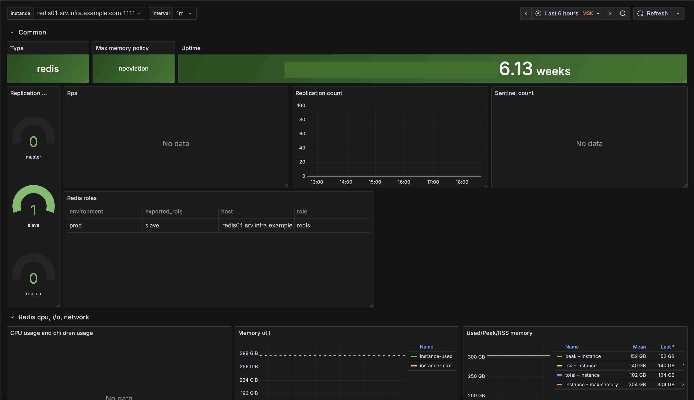

**Language / Язык:** [English](redis.md) | [Русский](../ru/parsers/redis.md)

## Redis

Redis can work with a password or on a Unix socket. Alligator allows the collection of metrics from any of these configurations:

```
aggregate {
    redis tcp://localhost:6379/;
    redis tcp://:pass@127.0.0.1:6379;
    redis unix:///tmp/redis.sock;
    redis unix://:pass@/tmp/redis.sock;
}
```

Sentinel follows a similar pattern:

```
aggregate {
    sentinel tcp://localhost:26379;
    sentinel tcp://:password@localhost:26379;
}
```

Ping-only availability (also usable as a `query` datasource):

```
aggregate {
    redis_ping tcp://localhost:6379 name=kv;
}

query {
    expr "MGET veigieMu ohThozoo ahPhouca";
    datasource kv;
    make redis_query;
}
```

### Metrics

`INFO` sections are mapped into Prometheus-style families (not a 1:1 dump of every Redis field):

| Family | Type | Notes |
|--------|------|--------|
| `redis_used_memory{type}` | gauge | `total` / `rss` / `peak` / `lua` |
| `redis_total_system_memory` / `redis_maxmemory` | gauge | |
| `redis_mem_fragmentation_ratio` | gauge | |
| `redis_maxmemory_policy{policy}` | gauge | Presence (`1`) |
| `redis_used_cpu{type}` | counter | `sys` / `user` / `*_children` (seconds) |
| `redis_error_stat{stat}` | counter | From `# Errorstats` |
| `redis_cmdstat_calls_total{cmd}` | counter | From `# Commandstats` |
| `redis_cmdstat_duration_seconds_total{cmd}` | counter | Cumulative command time (usec→seconds) |
| `redis_cmdstat_duration_seconds{cmd}` | gauge | Average seconds per call |
| `redis_keys` / `redis_expires` / `redis_avg_ttl` | gauge | Per logical DB |
| `redis_role` / `redis_master_link_status` | gauge | Label-encoded state |
| Other numeric `INFO` keys | gauge | Fallback `redis_<field>` |

Additional handlers: `redis_cluster`, `redis_memory_stat`, `redis_latency_stat` (`redis_latency_stat_seconds`, ms→seconds), `redis_ping`.

There is no dedicated `redis_up`; use `alligator_parser_ok{parser="redis"}` (and session metrics) for scrape success.

## Dashboard

The system dashboard for Grafana + Prometheus is available at the following [link](https://github.com/alligatormon/alligator/tree/master/dashboards/alligator-redis.json)

<br>
