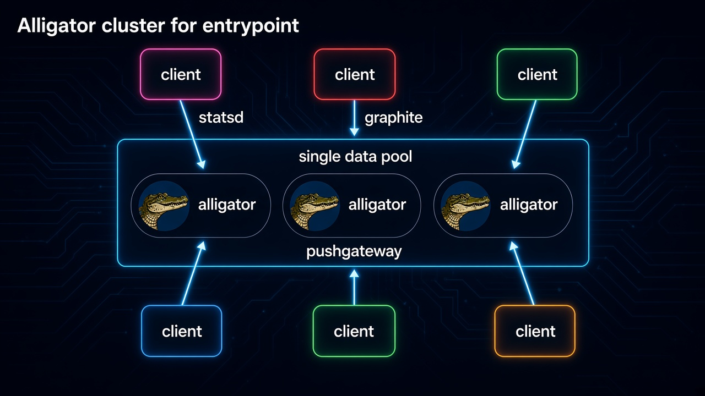
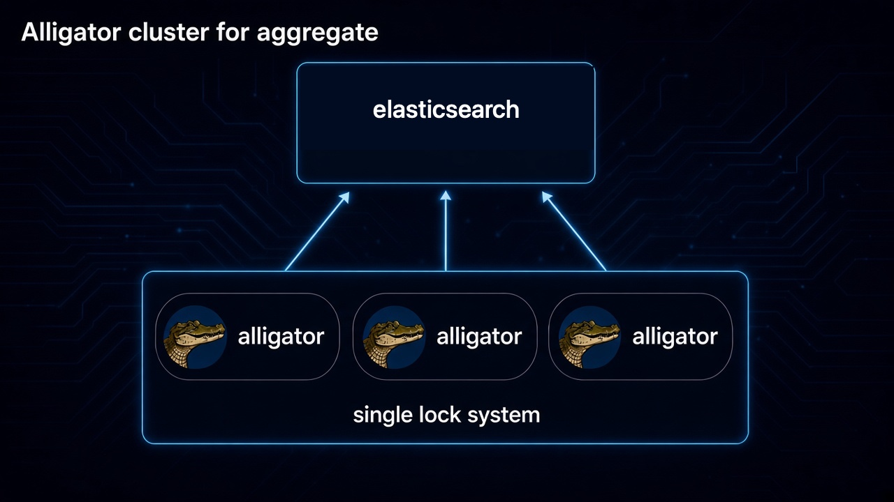

**Language / Язык:** [English](../cluster.md) | [Русский](cluster.md)

# Cluster
Alligator поддерживает два типа конфигурации кластера: для приёма метрик и для сбора метрик.
<br>
<p align="center">
<h1 align="center" style="border-bottom: none">
    </a><br>
</h1>
<br>
Если кластер включён в контексте aggregate, становится доступна lock-based кластеризация.
<br>
<h1 align="center" style="border-bottom: none">
    </a><br>
</h1>

<br>
<br>
</p>

Cluster включает многонодовые возможности и может использоваться в двух направлениях — как приёмник метрик или как crawler метрик. Gauge с нескольких хостов: [приём метрик](metric-receive.md#кластер-gauge-и-несколько-хостов).\
Чтобы настроить кластер-приёмник метрик, каждая нода должна быть сконфигурирована в entrypoint так:
```
entrypoint {
    tcp 1111;
    cluster repl;
    instance srv1.example.com:1111;
}
```

Чтобы настроить crawler метрик с эксклюзивной блокировкой, каждая нода должна сконфигурировать контекст aggregate так:
```
aggregate {
    elasticsearch http://localhost:9200/ cluster=repl instance=srv1.example.com:1111;
}
```


## name
Задаёт имя кластера, которое можно использовать как ссылку в aggregate, entrypoint или в API.


## type
Доступные значения:
- oplog
- sharedlock

Значение sharedlock можно использовать в контексте aggregate. Это позволяет выполнять исходящие запросы ровно один раз через кластер.
Oplog — вариант, который позволяет принимать и распределять метрики между нодами кластера.

Push шардируется Maglev по `sharding_key` (по умолчанию `__name__`). Primary отдаёт сэмпл из default namespace в `/metrics`. Копии `replica_factor` лежат в namespace `имя_кластера:primary_peer` для HA и попадают в scrape этой ноды только если sync TTL primary peer протух (failover). Prometheus должен скрейпить все члены кластера; в здоровом кластере каждая серия видна с одного Maglev primary.


## server
Задаёт все хосты кластера.


## size
По умолчанию: 1000
Задаёт размер oplog. Минимум **2** (`begin==end` = пусто, ёмкость `size-1`). Невалидные значения отклоняются, остаётся 1000. Если кольцо полное, каждая новая запись вытесняет **одну** самую старую (не весь лог). Каждый такой drop увеличивает `alligator_cluster_oplog_overflow_total{cluster,peer}` в default namespace (без TTL entrypoint/push).

Каждый POST `/oplog` (shift) и GET отдают не больше **1 MiB** накопившихся записей; остаток остаётся в кольце до следующего sync — чтобы peer не применял десятки мегабайт backlog одним вызовом на event loop.

Объём репликации (тоже default namespace; обновление ~1s с атомиков):

- `alligator_cluster_oplog_enqueued_total{cluster,peer}` — сэмплы, положенные в oplog для `peer` (на ноде, принявшей push)
- `alligator_cluster_oplog_applied_total{cluster,peer}` — сэмплы, применённые из sync `/oplog` с `peer`
- `alligator_cluster_oplog_overflow_total{cluster,peer}` — drop oldest при полном кольце peer’а


## shardinag\_key
По умолчанию: `__name__`

Задаёт ключ шардирования для распределения ключей по нодам кластера.


## replica\_factor
Повышает доступность метрик, если часть нод выходит из строя.


# Пример
```
cluster {
    name repl;
    size 10000;
    sharding_key __name__;
    replica_factor 2;
    type oplog;
    servers  srv1.example.com:1111 srv2.example.com:1111 srv3.example.com:1111;
}
```
