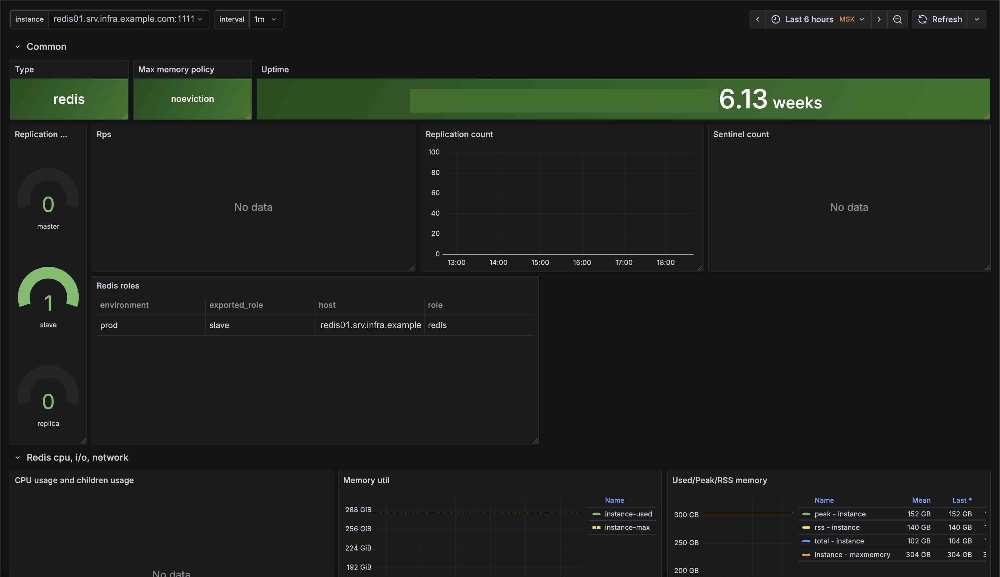

**Language / Язык:** [English](../../parsers/redis.md) | [Русский](redis.md)

## Redis

Redis может работать с паролем или через Unix-сокет. Alligator позволяет собирать метрики при любой из этих конфигураций:

```
aggregate {
    redis tcp://localhost:6379/;
    redis tcp://:pass@127.0.0.1:6379;
    redis unix:///tmp/redis.sock;
    redis unix://:pass@/tmp/redis.sock;
}
```

Sentinel — по тому же шаблону:

```
aggregate {
    sentinel tcp://localhost:26379;
    sentinel tcp://:password@localhost:26379;
}
```

Только ping (удобно как datasource для `query`):

```
aggregate {
    redis_ping tcp://localhost:6379 name=kv;
}

query {
    expr "MGET veigieMu ohThozoo ahPhouca";
    datasource kv;
    make redis_query;
}
```

### Метрики

Секции `INFO` мапятся в Prometheus-семейства (не полный dump всех полей Redis):

| Семейство | Тип | Примечание |
|-----------|-----|------------|
| `redis_used_memory{type}` | gauge | `total` / `rss` / `peak` / `lua` |
| `redis_total_system_memory` / `redis_maxmemory` | gauge | |
| `redis_mem_fragmentation_ratio` | gauge | |
| `redis_maxmemory_policy{policy}` | gauge | Присутствие (`1`) |
| `redis_used_cpu{type}` | counter | `sys` / `user` / `*_children` (секунды) |
| `redis_error_stat{stat}` | counter | Из `# Errorstats` |
| `redis_cmdstat_calls_total{cmd}` | counter | Из `# Commandstats` |
| `redis_cmdstat_duration_seconds_total{cmd}` | counter | Суммарное время команд (usec→секунды) |
| `redis_cmdstat_duration_seconds{cmd}` | gauge | Среднее время на вызов |
| `redis_keys` / `redis_expires` / `redis_avg_ttl` | gauge | По логической БД |
| `redis_role` / `redis_master_link_status` | gauge | Состояние через лейблы |
| Прочие числовые поля `INFO` | gauge | Fallback `redis_<field>` |

Доп. handlers: `redis_cluster`, `redis_memory_stat`, `redis_latency_stat` (`redis_latency_stat_ms`), `redis_ping`.

Отдельного `redis_up` нет — для успеха scrape используйте `alligator_parser_ok{parser="redis"}` и session-метрики.

## Dashboard

Системный дашборд для Grafana + Prometheus: [ссылка](https://github.com/alligatormon/alligator/tree/master/dashboards/alligator-redis.json)

<br>
