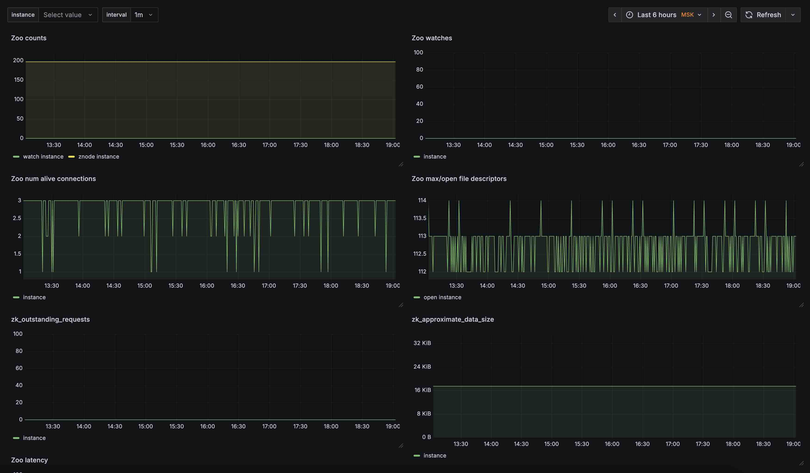

**Language / Язык:** [English](../../parsers/zookeeper.md) | [Русский](zookeeper.md)

# ZooKeeper

Alligator собирает метрики ZooKeeper с помощью four-letter words `mntr`, `isro` и `wchs`.

## Configuration

```
aggregate {
    zookeeper tcp://127.0.0.1:2181;
}
```

Также полезно проверять статистику процесса, запущенные сервисы и открытые порты:

```
system {
    process /zookeeper/;
    services zookeeper.service;
}

query {
	expr 'count by (src_port, process) (socket_listening{process="java", src_port="3888"})';
	make socket_match;
	datasource internal;
}

query {
	expr 'count by (src_port, process) (socket_listening{process="java", src_port="2181"})';
	make socket_match;
	datasource internal;
}

query {
	expr 'count by (src_port, process) (socket_listening{process="java", src_port="2888"})';
	make socket_match;
	datasource internal;
}
```

## Exported metrics

| Metric | Type | Source | Description |
|--------|------|--------|-------------|
| `zk_*` | gauge/counter | `mntr` | Числовые поля из `mntr`. Prometheus `{label="value"}` становятся лейблами. Известные переименования: `zk_avg_latency`→`zk_avg_latency_ms`, `zk_packets_*`→`zk_packets_*_total`, `zk_approximate_data_size`→`zk_approximate_data_size_bytes`. |
| `zk_mode` | gauge | `mntr` | Роль узла: `standalone`, `follower` или `leader`. |
| `zk_up` | gauge | `mntr` | 1, если последний scrape `mntr` вернул данные. |
| `zk_read_only` | gauge | `isro` | 1, если ZooKeeper ответил `ro`. |
| `zk_isro_status` | gauge | `isro` | Ответ `isro` как лейбл `status` (`ro`/`rw`/`null`). |
| `zk_watches` | gauge | `wchs` | Общее число watches. |

Все экспортируемые семейства включают метаданные Prometheus `# HELP` и `# TYPE gauge`.

## Example

Фрагмент `mntr`:

```
zk_avg_latency	10
zk_server_state	leader
zk_readlatency{quantile="0.5"}	0
zk_jvm_buffer_pool_capacity_bytes{pool="direct"}	385546
```

Экспортируется как `zk_readlatency{quantile="0.5"}` и `zk_jvm_buffer_pool_capacity_bytes{pool="direct"}`, а не как сплющенные имена вида `zk_readlatency_quantile__0_5__`.

Ответ `isro`:

```
rw
```

Фрагмент `wchs`:

```
Total watches:15
```

## Dashboard

Системный дашборд для Grafana + Prometheus доступен по следующей [ссылке](https://github.com/alligatormon/alligator/tree/master/dashboards/alligator-zookeeper.json)

<br>
